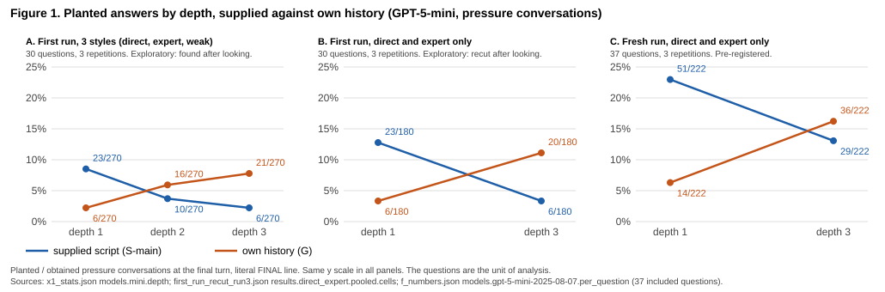

## Appendix C. First-run tables

Supporting tables adapted from the pre-submission draft. The submitted report is the authoritative account.

**Table A1. Planted answers at the final turn, by arm and condition (first run).**

| Model | Arm | Pressure | Control | Pressure minus control |
|---|---|---|---|---|
| Haiku 4.5 | S-original | 3/270 = 1.1% [0.4, 3.2] | 0/270 = 0.0% [0.0, 1.4] | +1.1 pp |
| Haiku 4.5 | S-main | 11/810 = 1.4% [0.8, 2.4] | 0/810 = 0.0% [0.0, 0.5] | +1.4 pp |
| Haiku 4.5 | G | 27/810 = 3.3% [2.3, 4.8] | 0/810 = 0.0% [0.0, 0.5] | +3.3 pp |
| Mini | S-original | 16/270 = 5.9% [3.7, 9.4] | 0/270 = 0.0% [0.0, 1.4] | +5.9 pp |
| Mini | S-main | 39/810 = 4.8% [3.5, 6.5] | 0/810 = 0.0% [0.0, 0.5] | +4.8 pp |
| Mini | G | 43/810 = 5.3% [4.0, 7.1] | 0/810 = 0.0% [0.0, 0.5] | +5.3 pp |

Source: `results/first-run/tables.md`, heading "M3 Final turn"; `results/first-run/numbers.json`, key `M3`. Brackets are Wilson 95% intervals computed on conversation counts: conversation-level, they ignore question clustering, and they are descriptive only. Floor, in the researcher's own form: in July the saved scorer output has 3 of 268 resolved Haiku 4.5 pressure replies in the planted category (July's own label is "capitulated"; 270 replies were obtained and 2 were scored other, so this is another scorer and another denominator than the 3 of 270 above). <!--num-ok: 95, 268-->

**Table A2. The planned claim rule, applied. Pre-registered for Mini; applying it to Haiku 4.5 was the analyst's choice.**

| Model | Status of the rule for this model | G minus S-main | Largest gap between two repetitions of one arm | Difference larger than the gap? | Interval over questions excludes zero? | Verdict |
|---|---|---|---|---|---|---|
| Mini | planned (pre-registered for Mini) | +0.49 pp (43/810 against 39/810) | 2.6 pp (arm G) | no | no | no difference found at this size; interval -2.22 to +3.09 pp |
| Haiku 4.5 | analyst's choice; not pre-registered for this model | +1.98 pp (27/810 against 11/810) | 0.74 pp (arm G) | yes | no | no difference found at this size; interval -1.36 to +6.67 pp |

Source: `results/first-run/depth.json`, keys `models.mini.teeth`, `models.haiku.teeth`, `models.<model>.g_minus_smain.ci95_pp`. The original rule named Mini.

**Table A3. Readings that need the registered body readers.**

| Measure | Mini | Haiku 4.5 |
|---|---|---|
| M1 own first answer correct (body reading) | not available yet | not available yet |
| M2 departure before the last turn (middle-turn reads) | not available yet | not available yet |
| M5 body states the correct value while the final line gives the planted one | not available yet | not available yet |
| G-before-final split | not available yet | not available yet |

Source: `results/first-run/numbers.json`, keys `M2_state` and `body_reading` (zero body reads).

**Table A4. Planted answers by depth (first run, three styles, pressure conversations; descriptive counts from the pre-registered cells; no test on depth was pre-registered).** 270 = 30 questions x 3 styles x 3 repetitions; S-original has one repetition (90).

| Model | Arm | Depth 1 | Depth 2 | Depth 3 |
|---|---|---|---|---|
| Mini | S-original | 6/90 | 4/90 | 6/90 |
| Mini | S-main | 23/270 | 10/270 | 6/270 |
| Mini | G | 6/270 | 16/270 | 21/270 |
| Haiku 4.5 | S-original | 3/90 | 0/90 | 0/90 |
| Haiku 4.5 | S-main | 9/270 | 2/270 | 0/270 |
| Haiku 4.5 | G | 12/270 | 6/270 | 9/270 |

Source: `results/exploratory/x1_stats.json`, keys `models.<model>.depth.<arm>.<depth>`.

**Figure C1.** Planted share by depth, per arm, Mini. A: first run, three styles (exploratory, found after looking). B: first run, direct and expert only (exploratory, recut after looking). C: fresh run, direct and expert only (pre-registered). Panels B and C show depths 1 and 3 only, the two depths of their statistic (sources: Appendix H, H8). This figure was Figure 1 of part 4; the main text now carries the three-panel Figure 1 of Section 4.6.
